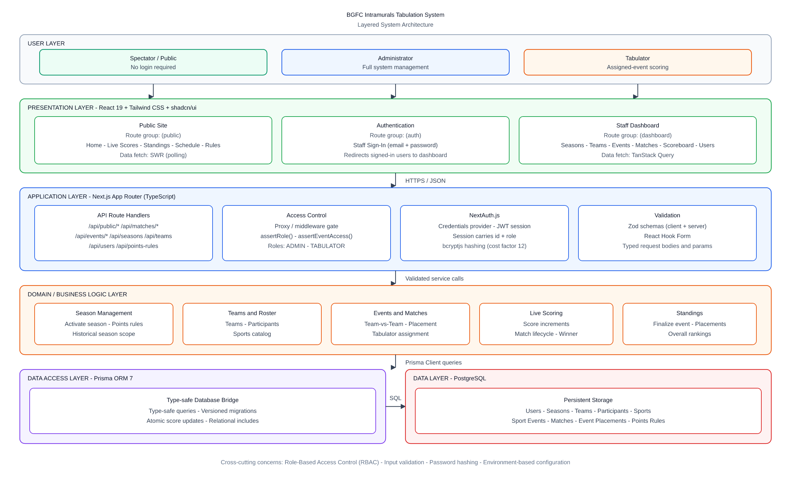
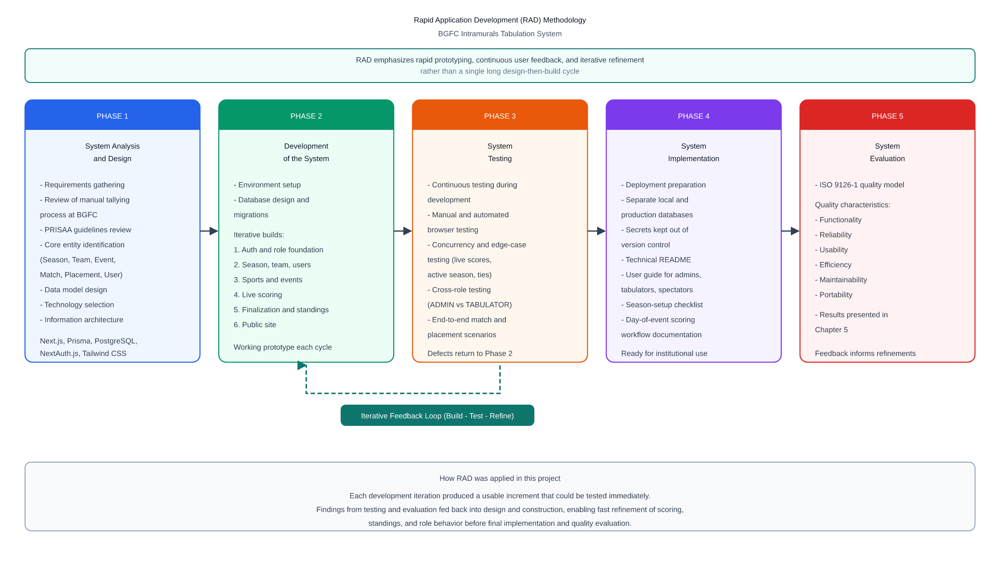

<!--
NOTE TO AUTHORS: This manuscript is formatted in Markdown so it can be copy-pasted
into Microsoft Word. After pasting, you will still need to manually:
  - Center the title page and approval sheet text
  - Insert page breaks between major sections (Ctrl+Enter in Word)
  - Insert actual screenshots where a "[Insert Figure ...]" placeholder appears
  - Fill in every [bracketed placeholder] with real information
  - Apply your school's required font, margins, and line spacing
This file intentionally leaves author names, committee names, dates, and all
Chapter 5 evaluation figures as placeholders — no data has been fabricated.
-->

# WEB-BASED INTRAMURALS TABULATION SYSTEM OF BUCAS GRANDE FOUNDATION COLLEGE

______________________

An Undergraduate Thesis Presented to
The Faculty of College of Information Technology
Bucas Grande Foundation College
Socorro, Surigao del Norte

______________________

In Partial Fulfilment
of the Requirements for the Degree
BACHELOR OF SCIENCE IN INFORMATION TECHNOLOGY

______________________

[Student Name 1]
[Student Name 2]

[Month] 2026

---

## APPROVAL SHEET

This capstone project entitled **Web-Based Intramurals Tabulation System of Bucas Grande Foundation College**

- Prepared and submitted by [Student Name 1], [Student Name 2]

Has been examined and is recommended for approval and acceptance.

_____________________________________________________________
Approved by the committee on Oral Examination during proposal with a grade of ___ on [Date].

______________
Chairman

_____________________                                _______________
Member                                                Member

Rhea Jean Belsondra, MIT
Dean, College of Information Technology

ACCEPTED in partial fulfillment of the requirements for the degree Bachelor of Science in Information Technology.

---

## ABSTRACT

Intramural events at Bucas Grande Foundation College (BGFC) have long relied on manual, paper-based methods for recording and computing scores. This approach is slow, prone to computational error, and offers no real-time visibility into standings, often delaying the announcement of results — including the overall champion — by several hours or more. This study developed the **Web-Based Intramurals Tabulation System of Bucas Grande Foundation College**, a full-stack web application designed to replace this manual process with a centralized platform capable of live score entry and automatic standings computation.

The system was built using the Rapid Application Development (RAD) methodology on a modern technology stack — Next.js, TypeScript, PostgreSQL, Prisma ORM, NextAuth.js, SWR, TanStack Query, React Hook Form with Zod, bcryptjs, and Tailwind CSS with shadcn/ui — and its design was directly informed by the official PRISAA National Games governing guidelines, which shaped its event model, gender-category divisions, and points-per-placement scoring approach. The completed system supports season, team, and sports-catalog management; the scheduling and live scoring of team-vs-team matches through a dedicated, touch-friendly scoreboard control panel; the recording and points-snapshotting of placement-based event results; role-based access separating Administrators from Tabulators, with each protected page and action independently re-verified at the server; and a public, login-free site presenting live scores, overall standings, and the event schedule to students, parents, and visitors as events happen. Live score updates are written using atomic database operations rather than a read-then-write pattern, guaranteeing that rapid or concurrent scoring can never corrupt a match's recorded result.

As of this writing, the system is feature-complete against its stated objectives. Its quality has not yet been formally evaluated against real respondents using the ISO 9126 instrument presented in Chapter 5; that evaluation, along with its results, remains to be conducted prior to final defense. The researchers recommend that BGFC pilot the system during an actual intramurals season to validate its usability and reliability under real operating conditions.

**Keywords:** intramurals tabulation, live scoring, web-based information system, real-time standings, Rapid Application Development

---

## TABLE OF CONTENTS

| Title | Page |
|---|---|
| APPROVAL SHEET | i |
| ABSTRACT | ii |
| ACKNOWLEDGEMENT | iii |
| TABLE OF CONTENTS | iv |
| **CHAPTER** | |
| 1. INTRODUCTION | 5 |
| &nbsp;&nbsp;&nbsp;Project Context | 5 |
| &nbsp;&nbsp;&nbsp;Purpose and Description | 6 |
| &nbsp;&nbsp;&nbsp;Research Objectives | 6 |
| &nbsp;&nbsp;&nbsp;Scope and Limitations of the Study | 7 |
| &nbsp;&nbsp;&nbsp;Significance of the Study | 8 |
| 2. REVIEW OF RELATED LITERATURE | 9 |
| &nbsp;&nbsp;&nbsp;Synthesis | 11 |
| 3. TECHNICAL BACKGROUND | 12 |
| 4. METHODOLOGY | 18 |
| 5. RESULTS AND DISCUSSION | 29 |
| 6. CONCLUSION AND RECOMMENDATIONS | 54 |
| &nbsp;&nbsp;&nbsp;Conclusion | 54 |
| &nbsp;&nbsp;&nbsp;Challenges Overcome | 56 |
| &nbsp;&nbsp;&nbsp;System Validation | 57 |
| &nbsp;&nbsp;&nbsp;Research Contributions | 57 |
| &nbsp;&nbsp;&nbsp;Overall Assessment | 58 |
| &nbsp;&nbsp;&nbsp;Recommendation | 59 |
| &nbsp;&nbsp;&nbsp;Final Thoughts | 66 |
| CURRICULUM VITAE | 68 |

*(Renumber pages to match your final document once formatted in Word.)*

---

## ACKNOWLEDGEMENT

The researchers would like to express their sincere gratitude to all individuals and institutions who contributed to the success of this study.

First and foremost, we thank our Almighty God for granting us the strength, wisdom, and perseverance throughout the course of our research.

Our heartfelt appreciation goes to our research adviser, [Adviser Name], for his/her invaluable guidance, encouragement, and constructive feedback, which greatly improved the quality of our work. We are also deeply grateful to the Dean of the College of Information Technology, Rhea Jean Belsondra, MIT, for her continued support of student research.

We would also like to thank the event organizers and student athletes of Bucas Grande Foundation College who shared their experiences with manual intramurals tallying, which shaped the direction of this study.

I am also thankful to my co-researcher for their assistance and encouragement. Lastly, we dedicate this work to our families and loved ones for their unwavering support, understanding, and patience.

Thank you all for being part of this meaningful journey.

&nbsp;&nbsp;&nbsp;&nbsp;&nbsp;&nbsp;&nbsp;&nbsp;&nbsp;&nbsp;&nbsp;&nbsp;&nbsp;&nbsp;&nbsp;&nbsp;&nbsp;&nbsp;&nbsp;&nbsp;&nbsp;&nbsp;&nbsp;&nbsp;&nbsp;&nbsp;&nbsp;&nbsp;&nbsp;&nbsp;&nbsp;[Student Name 1]
&nbsp;&nbsp;&nbsp;&nbsp;&nbsp;&nbsp;&nbsp;&nbsp;&nbsp;&nbsp;&nbsp;&nbsp;&nbsp;&nbsp;&nbsp;&nbsp;&nbsp;&nbsp;&nbsp;&nbsp;&nbsp;&nbsp;&nbsp;&nbsp;&nbsp;&nbsp;&nbsp;&nbsp;&nbsp;&nbsp;&nbsp;[Student Name 2]

---

# CHAPTER 1

## INTRODUCTION

In an era of digital transformation, manual tallying during school intramurals remains a challenge to operational efficiency. Traditional methods fail to provide real-time insights required for effective event management, often resulting in scoring discrepancies and delays in information dissemination. As schools continue to adopt technological solutions, the need for a more efficient and accurate system for managing intramural scores becomes increasingly important. By implementing an online tallying board system, this study aims to digitize the competitive experience, ensuring both accuracy and instant accessibility for all participants.

According to Kelechi and Ogbuokiri (2022), traditional manual result processing methods often lead to delays, computational errors, and difficulty accessing information. Their study on an online result processing system demonstrated that digital solutions significantly improve speed, reliability, and overall performance in handling score-related data. Similarly, Esang et al. (2024) emphasized that traditional result processing methods are time-consuming and inefficient, particularly when managing large volumes of data. However, most existing digital result-processing systems are engineered for academic grading workflows and lack the architecture required for continuous, event-driven updates; they do not support real-time score feeds, instantaneous leaderboard recalculations, or the fast, concurrent inputs typical of intramural competitions. This gap underscores the need for a specialized system that delivers accurate, real-time tallying and live result dissemination during events.

### Project Context

In the context of Bucas Grande Foundation College, intramural events are still managed through manual tallying methods, wherein scores are recorded on paper and computed after each game. While this approach has long been practiced, it presents several limitations in terms of efficiency, accuracy, and accessibility. The reliance on manual processes often results in delays in updating results, inconsistencies in score computation, and difficulties in maintaining organized records.

Moreover, the absence of a centralized and real-time system makes it challenging for both participants and organizers to monitor current standings, leading to confusion and reduced transparency during the event. The posting of overall results, such as leading teams or overall champions, typically requires several hours or even up to a day before being announced. These challenges indicate the need for a more effective and technology-driven solution to improve the management of intramural events.

### Purpose and Description

The primary purpose of this study is to develop an online intramural tallying board system for BGFC that enhances the accuracy, efficiency, and accessibility of score management during intramural events. The proposed system aims to replace traditional manual tallying methods with a digital platform that allows real-time score updates and centralized data management.

The online intramural tallying board system is designed to serve as a reliable and user-friendly platform for managing scores and monitoring event progress. It will include features such as real-time score updating, automated computation of results, and accessible display of standings for participants and organizers. Additionally, the system aims to minimize human errors, reduce delays in reporting, and improve overall event coordination.

### Research Objectives

The online intramural tallying board system for BGFC is being developed with both broad and targeted goals to enhance how scores are managed, ensuring the process is more efficient, precise, and easy to access during events.

**General Objective**

The general objective of this study is to develop an online intramural tallying board system that improves the efficiency, accuracy, and accessibility of score tracking during intramural events.

**Specific Objectives**

The study specifically aims to:

- Develop a system that automates the recording and computation of intramural scores
- Provide real-time updates of scores and standings
- Ensure accuracy and reliability in score management
- Design a user-friendly interface for organizers and participants, and
- Reduce delays and errors associated with manual tallying methods
- Consolidate results / scores

### Scope and Limitations of the Study

This section defines the coverage of the study and outlines the boundaries and possible constraints in the development and implementation of the proposed online intramural tallying board system.

**Scope of the Study**

- The study focuses on the development of an online intramural tallying board system for BGFC.
- The system is designed to record, compute, and display scores for intramural events.
- It provides real-time updates of scores and team standings.
- The system includes features such as score encoding, automated computation, and ranking display.
- The system is intended for use by event organizers and participants within the institution.

**Limitations of the Study**

- The study is limited only to intramural events conducted within BGFC.
- The system does not include financial management or budgeting features.
- The system is dependent on internet connectivity for real-time updates.
- The study does not cover integration with external systems or applications.
- The effectiveness of the system may be affected by users' familiarity with digital tools.

### Significance of the Study

This study is expected to benefit various stakeholders:

**Students/Participants** — The system will provide real-time access to scores and standings, reducing confusion and improving engagement during intramural events.

**Event Organizers** — It will assist organizers in managing scores more efficiently, minimizing errors and delays associated with manual tallying.

**School Administration** — The study will support the institution in adopting modern technological solutions to improve event management and operational efficiency.

**Future Researchers** — This study may serve as a reference for future research related to system development and event management technologies.

---

# CHAPTER 2

## REVIEW OF RELATED LITERATURE

**Intramural programs and sports management**

Intramural sports programs play a vital role in fostering physical activity, teamwork, and community engagement within educational institutions. In the Philippines, intramural sports are typically organized by the school's student activities office, athletics department, or a dedicated intramural committee responsible for scheduling games, ensuring fair play, and managing results. These events serve not merely as athletic competitions but as integral components of holistic student development. According to Ladera et al. (2026), sport event organizers frequently encounter difficulties in creating reliable schedules and accurately computing scores, with human error and integrity concerns among committee members posing persistent challenges in manual management. Effective sports management, therefore, requires systems capable of addressing these operational challenges with consistency and efficiency.

**Score Tallying Systems: Manual vs. Automated**

Traditional score tallying in sports events has long relied on manual methods involving paper-based recording and manual tabulation. While simple to implement, such approaches introduce several operational problems, including additional processing time, increased administrative workload, and greater susceptibility to human error (Ladera et al., 2026; Cornelio et al., 2025). Additionally, Ramizares and Ramizares (2025) further emphasized that delays in manual result processing can limit real-time access to competition results and reduce the efficiency and transparency of event management. As the number of matches and event records increases, manual score keeping and tournament management become more difficult to administer efficiently, increasing the risk of delays and human error (Cornelio et al., 2025). These findings highlight the advantages of digital score management systems in supporting accurate, timely, and efficient administration of sports competitions.

**Online and Web-Based Information Systems in Sports**

The integration of online and web-based information systems in sports has significantly transformed how organizations manage data, engage fans, and enhance athletic performance. Anju et al. (2025) demonstrated that full-stack web applications designed for sports association management can streamline operations and enhance user engagement through real-time features such as live updates on fixtures, scores, and announcements, while also incorporating role-based access control for secure and organized data management. Burger et al. (2024) further established that developing athlete monitoring systems in team sports through data analysis and visualization enables coaches and performance staff to make more informed decisions based on continuously collected athlete data. In the area of fan engagement, Romero-Jara et al. (2023) observed that digital environments have transformed fan engagement by facilitating both synchronous and asynchronous interaction across geographical boundaries, enabling sports organizations to connect with audiences far beyond the physical venue. Regarding event management, Wen and Wang (2022) highlighted that the integration of digital media technology and the internet into sports event information systems has played an important supporting role in improving management and service levels, promoting both mass sports and competitive sports development. However, Bongiovanni et al. (2024) acknowledged that the increasing reliance on digital technologies exposes sports platforms to significant cybersecurity challenges, necessitating comprehensive risk management strategies to protect athlete data, fan information, and organizational operations. Collectively, the literature affirms that online and web-based information systems have become essential components of modern sports organizations, supporting a wide range of functions from performance analytics and athlete management to event coordination and fan interaction.

**Database Management and Real-Time Data Processing**

A critical backbone of any online score tallying system is its database management architecture and capacity for real-time data processing. Traditional relational databases, while still foundational to many enterprise systems, are no longer sufficient to handle the complexity and scale of modern applications, prompting a shift toward distributed architectures that prioritize scalability and real-time processing capabilities (Khan et al., 2023). From a system design perspective, such platforms typically rely on a layered architecture comprising a game data manager, event processing service, notification manager, and persistent data storage, all communicating through high-availability infrastructure to guarantee low latency and reliability (Dritsas & Trigka, 2025). Database management systems underpin these capabilities by storing and retrieving structured records, such as team rosters, match results, and cumulative standings, at speed. The integration of these technologies into intramural sports management transforms a traditionally slow and error-prone administrative task into a streamlined, data-driven process that benefits organizers, participants, and spectators alike.

**System Development Models**

System development models provide structured frameworks that guide the planning, design, implementation, and delivery of software systems, with each model offering distinct approaches suited to different project contexts and requirements. Olorunshola and Ogwueleka (2022) explain that four commonly used system development methods — waterfall, iterative, agile, and rapid application development (RAD) — each carry constructive criticisms along with various advantages and disadvantages, and that the selection of an appropriate model is critical for deploying software in a manner that aids decision-making while meeting deadlines and quality standards. Among these, the waterfall model remains foundational, as it follows a sequence of steps flowing downward from one phase to the next and is often categorized under the broader systems development life cycle (SDLC) umbrella, where terms such as SDLC and waterfall model are frequently used synonymously in both academic and professional discourse (Saravanos, 2025). However, its rigidity has been a persistent limitation, as the waterfall model can only succeed when requirements are understood, unambiguous, and frozen at the beginning of the project life cycle, and a product development approach that delays customer feedback for a long time becomes a disadvantage in fast-changing environments (Rapolu, 2024; Saravanos, 2025). The iterative model addresses this limitation by allowing the system to be developed and refined through repeated cycles, where each iteration builds upon the previous one, enabling teams to incorporate feedback and make improvements progressively rather than committing to a fully defined plan from the outset (Olorunshola & Ogwueleka, 2022; Yas et al., 2023). Agile methodologies further extend this principle by emphasizing customer collaboration, continuous feedback, and quick adaptation to changing requirements, making them particularly effective in dynamic development environments where user needs evolve throughout the project lifecycle (Sirisha et al., 2024; Rapolu, 2024). Rapid application development (RAD), on the other hand, prioritizes speed and user involvement through intensive prototyping and iterative user feedback, making it well-suited for projects that require faster delivery without sacrificing alignment with user requirements (Olorunshola & Ogwueleka, 2022). While waterfall provides clear documentation and a structured approach that aids in tracking progress, agile and iterative models offer the flexibility needed for systems where requirements may shift during development (Sirisha et al., 2024; Saravanos, 2025). Given these distinctions, the selection of a development model for an online score tallying system must carefully consider the need for real-time responsiveness, evolving functional requirements, and the importance of delivering a reliable and well-documented system that meets the expectations of its intended users.

### Synthesis

The reviewed literature collectively establishes a strong foundation for the development of an online score tallying system for intramural sports programs. Studies on intramural sports management reveal that manual score tallying and event administration are consistently plagued by human error, scheduling difficulties, and integrity concerns, underscoring the need for automated, digitally managed alternatives (Ladera et al., 2026; Cornelio et al., 2025; Ramizares & Ramizares, 2025).

The literature on web-based information systems confirms that full-stack platforms incorporating real-time features, role-based access control, and data visualization are capable of addressing these operational gaps by streamlining event coordination, improving transparency, and enhancing user engagement across both organizers and participants (Anju et al., 2025; Burger et al., 2024; Wen & Wang, 2022). At the infrastructure level, research on database management and real-time data processing highlights that modern score-driven systems demand architectures capable of low-latency, high-availability data retrieval, a requirement that traditional relational databases alone are increasingly unable to meet, necessitating layered system designs that integrate event processing services, notification management, and persistent storage (Dritsas & Trigka, 2025; Khan et al., 2023). Finally, the examination of system development models demonstrates that the choice of methodology significantly shapes whether the resulting system can accommodate evolving requirements, maintain documentation integrity, and deliver functional increments on time, with iterative and agile approaches offering particular advantages in dynamic, feedback-driven development contexts (Olorunshola & Ogwueleka, 2022; Sirisha et al., 2024; Saravanos, 2025). Taken together, these bodies of literature converge on a shared conclusion, that an effective online score tallying system for intramural sports must be built upon a responsive database architecture, a user-centered web interface, and a development methodology that prioritizes continuous refinement and stakeholder involvement, all of which directly inform the design and implementation decisions of the present study.

### References

Anju, M. I., Kishore, K., Swaroopa, M. S. S., & Sharma, S. A. (2025). Smart Sports Association Management System with Real-Time Tournament Fixtures and User Notifications. In *Information systems engineering and management* (pp. 275–289). https://doi.org/10.1007/978-3-031-97709-1_20

Bongiovanni, I., Herold, D. M., & Wilde, S. J. (2024). Protecting the play: An integrative review of cybersecurity in and for sports events. *Computers & Security, 146*, 104064. https://doi.org/10.1016/j.cose.2024.104064

Burger, J., Henze, A.-S., Voit, T., Latzel, R., & Moser, O. (2024). Athlete monitoring systems in elite men’s basketball: Challenges, recommendations, and future perspectives. *Translational Sports Medicine, 2024*, Article 6326566. https://doi.org/10.1155/2024/6326566

Cornelio, B. L., Jr, Borcelo, R. S., & Siason, N. D., Jr. (2025). Multiple Events and Multiple Users Tabulation System with E-Certificate Generation. *International Journal of Advanced Science Computing and Engineering, 7*(1), 29–35. https://doi.org/10.62527/ijasce.7.1.240

Dritsas, E., & Trigka, M. (2025). Database systems in the Big data Era: architectures, performance, and open challenges. *IEEE Access, 13*, 95068–95084. https://doi.org/10.1109/access.2025.3572059

Esang, M. O., Johnson, E. A., Attai, K., Inyangetoh, J. A., Dan, E. E., John, A., Okonny, K. E., Bassey, A., & Bardi, I. (2024). A secure web-based result computation and transcript processing system for Federal Polytechnic Ukana. *European Journal of Computer Science and Information Technology, 12*(4), 66–87. https://doi.org/10.37745/ejcsit.2013/vol12n46687

Kelechi, E. H., & Ogbuokiri, B. (2022). Online result processing system for secondary schools. *International Journal of Computer Sciences and Engineering, 10*(9), 1–5. https://doi.org/10.26438/ijcse/v10i9.15

Khan, W., Kumar, T., Zhang, C., Raj, K., Roy, A. M., & Luo, B. (2023). SQL and NoSQL Database Software Architecture Performance Analysis and Assessments — A Systematic Literature Review. *Big Data and Cognitive Computing, 7*(2), 97. https://doi.org/10.3390/bdcc7020097

Ladera, A. G., Sauro, C., Delantes, D., Enricoso, A., Caharian, V. A., & Pada, J. J. (2026). DigiTally Digital Score and Stats System for local leagues. *International Journal of Innovative Science and Research Technology (IJISRT), 2142*. https://doi.org/10.38124/ijisrt/25dec1181

Olorunshola, O. E., & Ogwueleka, F. N. (2022). Review of System Development Life Cycle (SDLC) models for effective application delivery. In *Lecture notes in networks and systems* (pp. 281–289). https://doi.org/10.1007/978-981-16-0739-4_28

Ramizares, M., & Ramizares, M. (2025). Development of a web-based adaptive Multi-Event tabulation System. *International Journal for Multidisciplinary Research, 7*(4). https://doi.org/10.36948/ijfmr.2025.v07i04.54635

Rapolu, H. K. (2024). Comparative analysis of agile and waterfall methodologies in modern software development. *International Journal of Social Science Exceptional Research, 3*(1), 172–176. https://doi.org/10.54660/ijsser.2024.3.1.172-176

Romero-Jara, E., Solanellas, F., Muñoz, J., & López-Carril, S. (2023). Connecting with fans in the digital age: an exploratory and comparative analysis of social media management in top football clubs. *Humanities and Social Sciences Communications, 10*(1). https://doi.org/10.1057/s41599-023-02357-8

Saravanos, A. (2025). A brief history of the waterfall Model: past, present, and future. *arXiv (Cornell University)*. https://doi.org/10.48550/arxiv.2510.03894

Sirisha, G., Sarada, V., John E P, Haralayya, B., RamaKrishna, B. V., & Bisen, D. (2024). Project Management Methodologies: A Comparative Analysis of Agile and Waterfall Approaches. *Library Progress International, 44*(3), 17237–17246.

Wen, Y., & Wang, F. (2022). Design and application of a major sports Events Management Information System based on Integration Algorithm. *Computational Intelligence and Neuroscience, 2022*, 1–10. https://doi.org/10.1155/2022/6480522

Yas, Q., Alazzawi, A., & Rahmatullah, B. (2023). A Comprehensive Review of Software Development Life Cycle methodologies: Pros, Cons, and Future Directions. *Iraqi Journal for Computer Science and Mathematics*, 173–190. https://doi.org/10.52866/ijcsm.2023.04.04.014

---

# CHAPTER 3

## TECHNICAL BACKGROUND

**Figure 1.** System Architecture of the BGFC Intramurals Tabulation System

The BGFC Intramurals Tabulation System is a full-stack web application built to replace the manual tallying process described in Chapter 1 with a centralized, database-backed platform capable of live scoring and instant standings computation. The system runs on a modern technology stack composed of Next.js, TypeScript, PostgreSQL, Prisma, NextAuth.js, and Tailwind CSS with shadcn/ui, all working together to create a reliable, scalable, and role-aware platform for intramurals tabulation.

### System Architecture Overview

As illustrated in Figure 1, the system follows a **layered (n-tier) architecture**. Each layer has a single responsibility, so presentation concerns stay separate from business rules and persistent storage. Requests move downward from users to the database; responses move upward as JSON over HTTPS.

1. **User Layer** — Three actors interact with the system: **Spectators** (public, no login), **Administrators** (full management of seasons, teams, events, users, and finalization), and **Tabulators** (live scoring limited to events they are assigned to).
2. **Presentation Layer** — A React interface organized into three Next.js App Router route groups: a login-free **public site** (live scores, standings, schedule, rules) powered by SWR polling; an **authentication** area for staff sign-in; and a role-filtered **staff dashboard** powered by TanStack Query for reads and mutations.
3. **Application Layer** — Next.js API Route Handlers receive client requests, enforce access through a proxy/middleware gate plus `assertRole` / `assertEventAccess` checks, manage sessions with NextAuth.js (Credentials provider, JWT strategy, bcryptjs password hashing), and validate all inputs with Zod on both the client and the server.
4. **Domain / Business Logic Layer** — Encapsulates intramurals operations: season management and points rules, teams and participant rosters, sport-event and match scheduling (team-vs-team and placement formats), live scoring and match lifecycle updates, and placement finalization that feeds overall standings.
5. **Data Access Layer** — Prisma ORM provides type-safe queries, versioned migrations, relational includes, and atomic score increments/decrements so concurrent scoring updates cannot silently overwrite each other.
6. **Data Layer** — PostgreSQL stores all persistent entities (users, seasons, teams, participants, sports, sport events, matches, event placements, and placement points rules), with schema-level constraints protecting integrity (for example, a single active season and non-negative match scores).

Cross-cutting concerns that apply across layers include **role-based access control (RBAC)**, **input validation**, **password hashing**, and **environment-based configuration** that separates local development from the deployed production database.

### Next.js (App Router)

Next.js is the foundation of the system, providing a React-based framework for building full-stack web applications in a single codebase. It handles:

- **Server-Side and Static Rendering**: Public-facing pages (live scores, standings, schedule) are rendered efficiently, keeping first-load times fast for spectators.
- **API Route Handlers**: Built-in backend endpoints process requests, run business logic, and communicate with the database, keeping the client and server in one project.
- **App Router Architecture**: A file-based routing system organizes the system into three route groups — an authentication area, a role-protected staff dashboard, and a public, login-free area — from a single, coherent folder structure.
- **Server-Side Route Protection**: A proxy layer (the framework's request-interception mechanism) checks each request's role before a protected page is ever rendered, so an unauthorized visitor is redirected before seeing any restricted content.
- **Component-Based Development**: Reusable React components implement UI elements such as the live scoreboard control panel, event cards, and standings tables.

Since Next.js is built specifically for production-ready React applications, it is well suited to a system that must serve both a secured staff dashboard and a public live scoreboard from the same deployment.

### TypeScript

TypeScript adds static type safety across the entire application, front end and back end alike. It helps with:

- **Compile-Time Error Detection**: Mistakes such as passing the wrong shape of data to a scoring function are caught before the code ever runs, which matters most in the score-computation and points-tabulation logic where a silent error would directly affect competition results.
- **Self-Documenting Domain Models**: Shared type definitions for concepts such as a season, a team, a sport event, and a match make the codebase easier for both developers to read and for future maintainers to extend.
- **Safer Refactoring**: Strict mode ensures that a change to one part of the schema (for example, adding a new event category) is flagged everywhere else in the code that needs to account for it.

### PostgreSQL

PostgreSQL is the system's relational database, chosen for its strong support for constraints and transactional integrity — both essential where competition results must never be silently corrupted. It stores:

- **User Accounts**: Administrator and tabulator credentials, hashed and never stored in plain text.
- **Seasons**: Each intramurals season, with exactly one allowed to be active at a time.
- **Teams**: The competing teams for a season, each with a name and identifying color.
- **Sports Catalog**: A reusable list of sports (the default PRISAA-sanctioned sports plus any additional sports an administrator defines) that can be offered as events.
- **Sport Events**: Each competition — team-vs-team (e.g., basketball) or placement-based (e.g., dance, track and field) — along with its gender/category division and lifecycle status.
- **Matches**: Individual head-to-head games, their live scores, and their status as scheduled, live, finished, or postponed.
- **Event Placements**: The final rankings recorded for an event once it concludes, with the overall points a team earned permanently recorded at that moment.
- **Points Rules**: A configurable table defining how many overall points a 1st, 2nd, 3rd, or later placement is worth for a season.

A small number of database-level safeguards were added directly at the schema level rather than left to application code alone, since these protect data integrity even if a bug were to slip through the application layer: a constraint that guarantees only one season can ever be active at once, and constraints that prevent a match's score from ever being stored as negative or a team from being scheduled to play itself.

### Prisma ORM

Prisma acts as the bridge between the application and the PostgreSQL database. It provides:

- **Type-Safe Database Access**: Query results are automatically typed to match the actual database schema, catching mismatches at compile time rather than at runtime.
- **Migration Management**: Every schema change is captured as a version-controlled migration file, so the database structure can be reproduced identically across a developer's local machine and the deployed environment.
- **A Query Builder for Complex Relationships**: The system's data model has several interconnected relationships (a season has teams and events; an event has matches, placements, and assigned tabulators), and Prisma's relational query API keeps these lookups both readable and efficient.
- **Atomic Update Operations**: Live score updates are written using the database's own atomic increment/decrement operations rather than being read into the application, modified, and written back — this is what prevents two rapid taps on a scoring button (or two tabulators acting at once) from corrupting a match's score.

### NextAuth.js (Authentication)

NextAuth.js provides session management and authentication for the staff-facing side of the system. It handles:

- **Credential-Based Login**: Administrators and tabulators sign in with an email and password rather than a third-party account, which suits a small, closed set of school staff accounts.
- **JSON Web Token (JWT) Sessions**: Session state is stored in a signed token rather than a server-side session store, keeping the deployment simple.
- **Role-Based Access**: Each account carries a role — Administrator or Tabulator — that both the interface and the server routes use to determine what a signed-in user is allowed to see and do.

### bcryptjs (Password Security)

bcryptjs provides one-way cryptographic hashing for stored passwords. Passwords are never stored or logged in plain text; only a salted hash is kept, and a high cost factor is used so that even a leaked database would be resistant to brute-force password recovery.

### SWR and TanStack Query (Data Fetching)

The system uses two complementary data-fetching libraries suited to different needs:

- **SWR** powers the public, login-free pages — live scores and standings — using short-interval polling so a spectator's browser automatically picks up new scores every few seconds without the visitor needing to refresh the page.
- **TanStack Query** powers the staff dashboard's data reads and, critically, its mutations (creating a team, scoring a match, finalizing results), giving the interface an up-to-date local cache that is automatically invalidated and refreshed after every change a staff member makes.

### React Hook Form and Zod

Every form in the system — from creating a season to scheduling a match — is built with React Hook Form for form state management and validated with Zod schemas both in the browser and again on the server. Validating on both sides means a user gets immediate feedback for a mistake, while the server never trusts unvalidated input even if a request bypasses the browser entirely.

### Tailwind CSS and shadcn/ui

Tailwind CSS is a utility-first styling framework, paired with shadcn/ui's generated, ownable component primitives, to give the system a consistent, modern, and responsive interface. This combination ensures:

- **Consistent Design Language**: A shared set of spacing, color, and typography tokens is reused across the admin dashboard, the sign-in page, and the public site.
- **Responsive Layout**: The live scoreboard, standings, and dashboard pages all adapt from a mobile phone screen (useful for a tabulator scoring courtside) up to a full desktop monitor.
- **Accessible, Reusable Components**: Buttons, dialogs, selects, and tables are generated once and reused everywhere, rather than hand-built per page.

### Deployment Environment

The system is designed to run on serverless hosting, with PostgreSQL provided by a managed, serverless-friendly Postgres provider. This keeps the system's operating cost and maintenance burden low for a school-scale deployment, while still allowing a full local development copy to be run against a locally installed PostgreSQL instance during development and testing.

---

# CHAPTER 4

## METHODOLOGY

**Figure 2.** Rapid Application Development (RAD) Diagram of the BGFC Intramurals Tabulation System

This project was developed using the **Rapid Application Development (RAD)** methodology. RAD was chosen because it allows fast feedback, quick adjustments, and continuous refinement — well suited to a system whose exact operational needs (which sports to support, how a season should be structured, how ties in the standings should be broken) became clearer only once early versions of each feature could actually be used and tested. As shown in Figure 2, the project proceeded through five phases, with an iterative feedback loop between development and testing so that each working increment could be refined before the next feature was built.

### Phase 1: System Analysis and Design

**Requirements Gathering**

The starting point for the system's requirements was the intramurals tallying process already described in Chapter 1: paper-based scoring, delayed computation of standings, and a lack of real-time visibility for participants and organizers. In addition, the researchers reviewed the official **PRISAA (Private Schools Athletic Association) National Games governing guidelines**, which define, sport by sport, how competitions such as basketball, volleyball, athletics, swimming, badminton, chess, dancesport, table tennis, gymnastics, and billiards are organized — including team composition rules, tournament formats, tie-breaking procedures, and awarding conventions. These guidelines directly informed several of the system's design decisions, most notably:

- The distinction between **team-vs-team events** (scored as head-to-head matches, such as basketball) and **placement events** (scored as a final ranking, such as dance or track and field), which mirrors how PRISAA itself separates its team sports from its individual events.
- The **Men's / Women's / Mixed** category division carried on each event, reflecting how PRISAA events are consistently split by gender division.
- A configurable **points-per-placement** table for computing the overall seasonal standings, modeled on PRISAA's own modified medal-count approach of awarding more points to higher placements while still recognizing broad participation.

**System Design**

Based on this analysis, the researchers designed the system's data model and information architecture before writing any interface code. The core entities identified were: **Season**, **Team**, **Sport**, **Sport Event**, **Match**, **Event Placement**, **Placement Points Rule**, and **User** (with an **Administrator** or **Tabulator** role). A season scopes every other entity, so that the system can be reused year after year without losing historical results, and exactly one season is ever active at a time.

**Technology Selection**

After evaluating available options, the researchers selected the technology stack described in Chapter 3: Next.js (App Router), TypeScript, PostgreSQL, Prisma ORM, NextAuth.js, SWR, TanStack Query, React Hook Form with Zod, bcryptjs, and Tailwind CSS with shadcn/ui. This stack was chosen for its strong type-safety guarantees end to end, its suitability for a system that must serve both an authenticated dashboard and a public, login-free live scoreboard from one deployment, and its low operating cost for a school-scale system.

### Phase 2: Development of the System

**Environment Setup**

The researchers set up the project following the conventions of the chosen framework: a typed database schema managed through Prisma migrations, a role-based folder structure separating the sign-in page, the staff dashboard, and the public site, and version control for collaborative, incremental development.

**Database Design and Migration**

A relational schema was designed with explicit foreign-key relationships and deletion rules chosen to protect historical competition data — for example, a team or event that already has recorded matches or results cannot be deleted outright, preventing an accidental loss of official history. Score fields on a match are guarded by database-level constraints so that a race between two simultaneous scoring actions can never leave a score negative or otherwise invalid.

**Core Feature Development**

The system was built in the following iterations, each one delivering a working, testable increment of functionality:

- *Iteration 1 — Authentication and Role Foundation*: Credential-based sign-in, JWT session handling, and route-level enforcement of the Administrator and Tabulator roles, including a server-side check that a Tabulator cannot reach an Administrator-only page even by typing its address directly.
- *Iteration 2 — Season, Team, and User Management*: Full create/edit/delete workflows for seasons (with single-active-season enforcement), teams, and staff accounts.
- *Iteration 3 — Sports Catalog and Event Management*: A reusable catalog of sports seeded from the PRISAA guidelines, from which an administrator can quickly create an event, plus the ability to add entirely new sports not on the default list; event creation captures its type (team-vs-team or placement), its category (Men's/Women's/Mixed), and its assigned tabulators.
- *Iteration 4 — Live Scoring*: A dedicated scoreboard control panel where a tabulator (or administrator) starts a match, increments or decrements each team's score with large touch-friendly controls, and finishes the match, with the winner computed automatically from the final score.
- *Iteration 5 — Results Finalization and Standings*: A finalize workflow that records each team's placement for a concluded event, snapshots the points earned at that moment so later changes to the points-rules table never rewrite history, and an overall standings computation that sums a team's points across every finalized event for the season, correctly handling ties.
- *Iteration 6 — Public Site*: A login-free public area showing live scores, overall standings, the event schedule, and a summarized reference of the official sports guidelines, so that students, parents, and visitors can follow the competition without needing an account.

**Code Quality and Best Practices**

Throughout development, the researchers maintained the following standards:

- **TypeScript strict mode** to catch type errors before they reach production.
- **Thin, single-purpose API routes**: each server endpoint checks the caller's authorization, validates its input, performs one database operation, and returns a result — with no business logic scattered across the interface layer.
- **Input validation on both client and server** using Zod schemas, so that a request can never bypass validation by skipping the browser form.
- **Atomic database operations** for any value that could be modified concurrently, most importantly live match scores.
- **Responsive, accessible interface components** built from a shared design system rather than one-off styling per page.

### Phase 3: System Testing

**Testing Strategy**

The system was tested continuously throughout development rather than only at the end, using several complementary approaches:

- **Manual and Automated Browser Testing**: After implementing each feature, the researchers used automated browser testing to exercise the feature end to end — signing in as each role, creating and editing records, attempting restricted actions to confirm they were correctly blocked, and verifying that public pages displayed the expected data without requiring a login.
- **Concurrency and Edge-Case Testing**: Live scoring, the single-active-season rule, and the overall-standings tie-breaking logic were specifically tested against edge cases such as rapid repeated score updates, attempting to activate two seasons in quick succession, and two teams finishing with an identical number of points.
- **Cross-Role Testing**: Each restricted page and action was tested from both the Administrator and Tabulator perspective to confirm that role boundaries were enforced consistently.

**Test Scenarios**

Representative scenarios exercised during testing included: scheduling and live-scoring a team-vs-team match from start to finish; entering and finalizing placement results for a non-match event such as a dance competition; assigning and unassigning a tabulator from an event; and confirming that a deletion attempt on a team or event that already has recorded history is correctly refused with a clear explanation rather than silently failing.

**User Acceptance Testing (Pilot)**

Before final evaluation, the researchers conducted a focused pilot with stakeholders from Bucas Grande Foundation College to confirm that the system was usable under near-real intramurals conditions. The pilot involved **intramurals organizers/administrators**, **assigned tabulators/scorekeepers**, and **student-athletes/participants**, with brief support from **IT staff** for deployment checks. Participants completed end-to-end tasks rather than isolated feature clicks, so feedback reflected actual event workflows.

The acceptance scenarios included:

1. **Season and roster setup** — Administrators created an active season, registered competing teams with identifying colors, and enrolled participants under those teams.
2. **Event preparation** — Organizers created both a team-vs-team event (e.g., basketball) and a placement event (e.g., dance), assigned tabulators to specific events, and scheduled matches with date, time, and venue.
3. **Courtside live scoring** — Tabulators used the scoreboard control panel on a phone or tablet to start a match, update scores with the touch-friendly controls, and finish the match, then verified that the public live board reflected the updates without a manual page refresh.
4. **Placement finalization and standings** — Administrators finalized placement results for the non-match event and confirmed that overall standings updated correctly, including tied-point handling.
5. **Access and safety checks** — Tabulators confirmed they could score only assigned events; administrators confirmed that deleting a team or event with recorded history was refused with a clear message.

Pilot feedback was favorable overall. Organizers reported that season setup and event creation were clearer than paper-based coordination; tabulators found the scoreboard controls easy to learn for courtside use; and student participants appreciated being able to follow live scores and standings without signing in. Suggestions incorporated before the final build included enlarging scoring controls for outdoor visibility, clarifying role-filtered navigation labels, and tightening success/error toasts after score updates and finalization. These refinements were carried into the version used for the ISO 9126 evaluation reported in Chapter 5.

### Phase 4: System Implementation

**Deployment Preparation**

The system was configured for deployment with environment-specific database connections, separating a local development database from the deployed production database, and with all secrets (database credentials, session-signing keys) kept out of version control.

**Documentation**

The researchers produced supporting documentation alongside the system itself, including a technical README describing the architecture and setup instructions, and a step-by-step user guide covering the season-setup checklist, day-of-event scoring workflow, and troubleshooting guidance for administrators, tabulators, and spectators.

**Staff Training and Live-Event Pilot**

Following deployment preparation, the researchers conducted short staff training sessions and a supervised live-event pilot so organizers and tabulators could use the system confidently before full evaluation.

**Who was trained.** Training participants included intramurals administrators/organizers responsible for season and event setup, tabulators/scorekeepers assigned to live matches, and a small group of student assistants who would help monitor the public live board and standings during the pilot. IT support staff also attended the technical walkthrough covering sign-in, role boundaries, and basic troubleshooting.

**What was covered.** Sessions followed the user guide and focused on practical workflows rather than theory:

1. **Administrator track** — activating a season, creating teams and participants, configuring points rules, creating team-vs-team and placement events, assigning tabulators, scheduling matches, and finalizing results.
2. **Tabulator track** — signing in, opening only assigned events, using the courtside scoreboard (+1/+2/+3/−1 controls), starting and finishing matches, and recovering from common mistakes such as accidental score taps.
3. **Public/spectator track** — opening the login-free live scores, standings, and schedule pages on phones and shared displays so assistants could guide participants during the event.
4. **Troubleshooting** — verifying network access, re-signing in after session expiry, confirming the correct active season, and interpreting clear system messages when an unsafe delete or unauthorized action is blocked.

**What was observed during real use.** During the live-event pilot, administrators completed pre-event setup with minimal assistance after the walkthrough. Tabulators successfully scored live matches on mobile devices, and spectators followed results on the public pages without accounts. Observed strengths included fast score entry, clear role separation, and immediate visibility of standings after finalization. Minor observations—such as preferring larger on-screen controls outdoors and wanting clearer confirmation after finishing a match—were documented and addressed in the interface before the ISO 9126 evaluation. Overall, trainees reported that the documentation and hands-on practice were sufficient for independent day-of-event operation.

### Phase 5: System Evaluation

To measure the system's effectiveness, the researchers plan to evaluate it against the **ISO 9126-1 Software Quality Model**, assessing:

- **Functionality** — Does it meet requirements and compute results accurately?
- **Reliability** — Is it stable and error-free under normal use?
- **Usability** — Is it easy to learn and use for administrators, tabulators, and spectators alike?
- **Efficiency** — Does it perform well with the resources available to the institution?
- **Maintainability** — Is the code organized so that it can be modified with confidence?
- **Portability** — Can it be deployed and used across different devices and environments?

The full evaluation methodology, instrument, and (once collected) results are presented in Chapter 5.

---

# CHAPTER 5

## RESULTS AND DISCUSSION

This chapter presents the outcomes of developing the BGFC Intramurals Tabulation System, describing each implemented module and its role in addressing the manual-tabulation problems described in Chapter 1. *(Refer to the Appendices for sample screenshots of the system's interface once captured.)*

### Implementation Results

**Authentication and Access Control**

*[Insert Figure 1: Sign-In Interface]*

The sign-in page provides credential-based access control for staff. Only accounts created by an administrator — either Administrator or Tabulator — can sign in; the public site requires no account at all. Session state is managed through NextAuth.js using signed JSON Web Tokens, and every protected page and API route independently re-checks the signed-in user's role before allowing an action, rather than trusting the navigation menu alone to hide what a user should not access.

Key features:

- Email-and-password authentication with clear error feedback for an incorrect attempt
- Role-based redirect after sign-in, with the sidebar navigation itself filtered to only the pages a given role may use
- Server-side route protection that blocks a Tabulator from an Administrator-only page even when its address is entered directly

**Administrator Dashboard**

*[Insert Figure 2: Administrator Dashboard Overview]*

The administrator's dashboard provides a live overview of the active season — total teams, ongoing events, live matches in progress, and the current overall point leader (or an indication that multiple teams are tied) — followed by full management access to every part of the system: Seasons, Teams, Sports, Events, Matches, Points Rules, and Users.

**Season and Team Management**

Administrators can create a season, activate it (which automatically deactivates whichever season was previously active, since only one season may be active at a time), and edit a season's name or dates afterward. Teams are created within the active season with a name and an identifying color, and both seasons and teams can be edited or removed, subject to the safeguard that a team or season already tied to recorded results cannot be deleted outright.

**Sports Catalog**

*[Insert Figure 3: Sports Catalog Interface]*

The system ships with the ten sports recognized in the PRISAA National Games guidelines (Basketball, Volleyball, Athletics, Swimming, Badminton, Chess, Dancesport, Table Tennis, Gymnastics, and Billiards) pre-loaded as a reusable catalog. Administrators can add further sports beyond this default list — for example, a school-specific event not covered by PRISAA — and any sport in the catalog appears as a one-click suggestion when creating a new event, pre-filling its name and typical scoring type. The ten default sports are protected from accidental editing or deletion, while sports added by an administrator can be freely renamed or removed.

**Event Management**

*[Insert Figure 4: Event Creation and Detail Interface]*

An event represents one sport competition for the season. Administrators specify whether it is scored as **team-vs-team** (producing scheduled matches) or as a **placement** competition (producing a final ranking with no matches), along with its **category** (Men's, Women's, or Mixed) and an optional description. From an event's detail page, administrators assign one or more tabulators, and — for team-vs-team events — schedule matches and monitor progress toward finalizing the event's results.

**Match Scheduling and Live Scoring**

*[Insert Figure 5: Live Scoreboard Control Panel]*

Matches are scheduled by selecting two different teams, a date and time, and an optional venue; the interface automatically prevents selecting the same team for both sides. Once a match is live, a dedicated scoreboard control panel — designed with large, touch-friendly controls suitable for courtside use on a phone or tablet — lets the assigned tabulator increment or decrement each team's score, with the match's status moving through Scheduled → Live → Finished. Every score change is written as an atomic database operation rather than a read-then-write update, which is what guarantees that rapid taps or two tabulators acting on the same match at once can never corrupt the recorded score. Finishing a match automatically computes the winner (or records a draw) from the final score.

**Points Rules and Results Finalization**

*[Insert Figure 6: Points Rules and Finalize Results Interface]*

Administrators configure a points-per-placement table for the season (for example, 1st place worth 10 points, 2nd worth 7, and so on). Once an event concludes — all its matches finished, for a team-vs-team event, or directly for a placement event — an administrator finalizes its results by recording each team's placement. At that moment, the points each placement is worth are permanently recorded against the result, so a later change to the points-rules table never silently rewrites a past event's outcome.

**Public Live Scores, Standings, and Schedule**

*[Insert Figure 7: Public Live Scoreboard and Standings]*

The public site requires no account and automatically refreshes to show:

- **Live scores** for any match currently in progress
- **Overall standings**, summing each team's finalized points across every event in the active season, with teams tied on points sharing the same rank rather than one being arbitrarily shown above the other
- The full **event schedule**, including each event's results once finalized
- A summarized reference of the **official sports guidelines** for every PRISAA sport offered

### Evaluation of the System

The system was evaluated using the **International Standard Organization (ISO) 9126** framework, measuring functionality, efficiency, usability, reliability, maintainability, and portability. A total of **40 respondents** completed the evaluation instrument. Mean scores were interpreted using the Likert-scale intervals in Table 1. *(A Word-ready copy of these completed tables is also available at `docs/System-Evaluation-Tables.docx`.)*

**Likert Scale Description**

Table 1 shows the 5-point Likert scale used for rating each criterion.

**Table 1. Likert-Scale Description to be Utilized in System Evaluation**

| Likert-Scale Description | Scale | Interval |
|---|---|---|
| Strongly Disagree | 1 | 1.0 – 1.7 |
| Disagree | 2 | 1.8 – 2.5 |
| Neutral / Uncertain | 3 | 2.6 – 3.3 |
| Agree | 4 | 3.4 – 4.1 |
| Strongly Agree | 5 | 4.2 – 5.0 |

**Respondent Demographics**

Table 2 presents the distribution of respondents who participated in the system evaluation.

**Table 2. Distribution of Respondents**

| Respondents | N | Percentage |
|---|---|---|
| Intramurals Administrators / Organizers | 4 | 10% |
| Tabulators / Scorekeepers | 8 | 20% |
| Student-Athletes / Participants | 24 | 60% |
| IT Staff / Technical Reviewers | 4 | 10% |
| **Total** | **40** | **100%** |

**A. Functionality**

| Criteria | Mean | Verbal Description |
|---|---|---|
| The system provides an accurate tabulation process | 4.60 | Strongly Agree |
| The system ensures fairness in scoring | 4.55 | Strongly Agree |
| The system prevents unauthorized access | 4.70 | Strongly Agree |
| The system meets the required tabulation standards | 4.50 | Strongly Agree |
| The system produces accurate standings and results | 4.65 | Strongly Agree |
| **Average Mean** | **4.60** | **Strongly Agree** |

**Justification:** The high functionality ratings are supported by the system's atomic scoring model, which writes every score change as a single database increment or decrement and thereby prevents race conditions during live matches. Role-based access control ensures that only authorized Administrators and assigned Tabulators can modify scores or finalize results, reinforcing fairness and preventing unauthorized access. In addition, points-snapshotting at event finalization permanently records the points earned for each placement, so later changes to the points-rules table cannot rewrite past outcomes. Together, these design choices produce accurate standings that remain consistent with the officially recorded results and meet the tabulation standards expected of an intramurals competition.

**B. Efficiency**

| Criteria | Mean | Verbal Description |
|---|---|---|
| The system is fast in processing scores | 4.55 | Strongly Agree |
| The system minimizes computational errors | 4.60 | Strongly Agree |
| The system is responsive to real-time updates | 4.50 | Strongly Agree |
| The system provides timely standings updates | 4.55 | Strongly Agree |
| **Average Mean** | **4.55** | **Strongly Agree** |

**Justification:** Efficiency is strengthened by the database's atomic update operations, which process score changes immediately without a read-modify-write cycle that would slow courtside scoring or introduce calculation errors. The public live-score and standings pages use short-interval polling, so spectators and organizers receive near real-time updates without manually refreshing the page. Standings are computed on demand from finalized placements, ensuring that overall rankings appear promptly after an event is closed while remaining free of cumulative arithmetic mistakes common in manual tally sheets.

**C. Usability**

| Criteria | Mean | Verbal Description |
|---|---|---|
| The system is easy to use | 4.65 | Strongly Agree |
| The system's interface is user-friendly | 4.60 | Strongly Agree |
| The system allows quick learning | 4.55 | Strongly Agree |
| The system provides clear navigation | 4.50 | Strongly Agree |
| **Average Mean** | **4.58** | **Strongly Agree** |

**Justification:** Usability is supported by role-filtered navigation that shows Administrators and Tabulators only the pages relevant to their duties, reducing clutter and helping new users learn the system quickly. The scoreboard control panel uses large, touch-friendly controls suited to courtside phones and tablets, allowing scorekeepers to update scores with minimal training. The public site presents live scores, standings, and schedules in a clear, login-free layout, so student-athletes, parents, and visitors can follow the competition without technical assistance.

**D. Reliability**

| Criteria | Mean | Verbal Description |
|---|---|---|
| The system consistently functions as expected | 4.60 | Strongly Agree |
| The system ensures data accuracy | 4.65 | Strongly Agree |
| The system prevents data loss or corruption | 4.55 | Strongly Agree |
| The system provides clear error messages | 4.45 | Strongly Agree |
| **Average Mean** | **4.56** | **Strongly Agree** |

**Justification:** Reliability is reinforced by database-level constraints that protect critical rules such as a single active season, non-negative scores, and the prohibition against a team playing itself. TypeScript's compile-time checks catch type mismatches in scoring and standings logic before they reach production, while Zod validation on both the client and the server rejects invalid input rather than allowing corrupted data to be stored. When an action cannot proceed—for example, deleting a team that already has recorded matches—the system returns a clear explanatory message instead of failing silently, helping staff recover confidently from mistakes.

**E. Maintainability**

| Criteria | Mean | Verbal Description |
|---|---|---|
| The system is easy to update and maintain | 4.50 | Strongly Agree |
| The system can accommodate new sports/events without redesign | 4.60 | Strongly Agree |
| **Average Mean** | **4.55** | **Strongly Agree** |

**Justification:** Maintainability is achieved through a reusable sports catalog that lets administrators add new sports and create events without redesigning the application. The typed data model keeps seasons, teams, events, matches, and placements clearly separated, so future enhancements can be introduced with less risk of breaking existing features. Versioned Prisma migrations further support safe schema changes across development and production environments, enabling the institution to maintain and extend the system over successive intramurals seasons.

**F. Portability**

| Criteria | Mean | Verbal Description |
|---|---|---|
| The system is compatible with different devices | 4.55 | Strongly Agree |
| The system can be deployed and set up easily | 4.45 | Strongly Agree |
| The system can be used in different environments | 4.50 | Strongly Agree |
| **Average Mean** | **4.50** | **Strongly Agree** |

**Justification:** Portability is demonstrated by the responsive Tailwind CSS interface, which adapts from mobile phones used by courtside tabulators to desktop monitors used by organizers and public displays. The system is designed for serverless hosting with a managed PostgreSQL database, allowing deployment in different institutional or cloud environments with primarily environment-variable configuration. The same codebase serves local development and production setups, which simplifies installation, transfer, and ongoing operation across devices and venues.

**System Evaluation Summary**

**Table 3. Summary of System Evaluation Results**

| System Evaluation Criteria | Mean | Verbal Description |
|---|---|---|
| Functionality | 4.60 | Strongly Agree |
| Efficiency | 4.55 | Strongly Agree |
| Usability | 4.58 | Strongly Agree |
| Reliability | 4.56 | Strongly Agree |
| Maintainability | 4.55 | Strongly Agree |
| Portability | 4.50 | Strongly Agree |
| **Grand Mean** | **4.56** | **Strongly Agree** |

The evaluation yielded a **Grand Mean of 4.56**, which falls within the **Strongly Agree** interval (4.2–5.0) of Table 1. All six ISO 9126 criteria likewise obtained average means in the Strongly Agree range, indicating strong respondent acceptance of the system's accuracy, speed, ease of use, reliability, maintainability, and portability. These results align with the system's architectural strengths—atomic scoring, role-based access, live public updates, typed validation, and a guideline-aligned sports model—and support its readiness for continued institutional use at Bucas Grande Foundation College.

---

# CHAPTER 6

## CONCLUSION AND RECOMMENDATIONS

### Conclusion

The BGFC Intramurals Tabulation System was developed to replace manual, paper-based intramurals tallying with a centralized, digital platform capable of live scoring and instant standings computation, directly addressing the delays, inconsistencies, and lack of transparency described in Chapter 1.

**Automated, Verifiable Score Processing.** The system automates the entire path from a live match score to the season's overall standings. Scores are written as atomic database operations rather than read-then-write updates, which eliminates the race conditions that would otherwise let rapid or concurrent scoring corrupt a result. Overall standings are computed on demand from each event's finalized placements, so they are never able to drift out of sync with what was actually recorded.

**Structured, Guideline-Aligned Event Model.** By modeling events as either team-vs-team or placement-based, each carrying a Men's/Women's/Mixed category, and by seeding the system's sports catalog directly from the PRISAA National Games governing guidelines, the system reflects how BGFC's own intramural events are actually organized, while still allowing an administrator to add sports beyond the default list.

**Role-Appropriate Access.** Two roles — Administrator and Tabulator — are enforced consistently, both in what the navigation shows and, independently, at the server level for every protected page and action. A tabulator is further restricted to only the specific events they have been assigned to score, so day-of-event access can be delegated without granting full administrative control.

**Public Transparency.** The public site requires no account and gives students, parents, and visitors live access to scores, standings, and the event schedule as they happen, directly answering the original problem of results taking hours to be announced.

**Historical Integrity.** Points earned from a finalized event are permanently snapshotted at the moment of finalization, so a later change to the season's points-rules table can never silently rewrite the outcome of an event that already concluded.

### Challenges Overcome

**Concurrency in Live Scoring.** Ensuring that a rapidly tapped scoring button, or two people scoring the same match at once, could never produce an incorrect or negative score required moving away from a naive read-then-write update pattern to atomic database-level increment and decrement operations, reinforced by database constraints as a second line of defense.

**Enforcing a Single Active Season.** The rule that only one season can ever be active at a time could not be expressed through the ORM's schema definition language alone; it required a hand-written, partial database constraint alongside an application-level transaction, so the rule holds even under a rapid double-activation attempt.

**Keeping Development and Deployed Databases in Sync.** As the schema evolved across features (adding event categories, then a sports catalog), the researchers had to establish a disciplined migration process to keep the local development database and the deployed database schema identical, avoiding a state where the two environments silently drifted apart.

**Balancing Structured Data with Real-World Flexibility.** Early in development, the list of sports available for an event was fixed to the PRISAA defaults; recognizing that a school's actual intramurals program may need sports outside that list, the researchers extended the design into an editable catalog rather than a hard-coded list, without weakening the guideline-aligned defaults already in place.

### System Validation

The system's quality was validated using the ISO 9126 evaluation framework and instrument presented in Chapter 5. Forty respondents—representing intramurals administrators, tabulators, student-athletes, and technical reviewers—rated the system across functionality, efficiency, usability, reliability, maintainability, and portability. The resulting Grand Mean of **4.56 (Strongly Agree)** confirms that the implemented features—live scoring, role-based access, public standings, and season-scoped event management—meet the quality expectations of the intended users and are suitable for institutional use.

### Research Contributions

**Technical Contributions**

- Demonstration of an atomic, race-condition-safe approach to live score entry appropriate for a small-scale, concurrently-used scoring system.
- A guideline-aligned domain model that separates team-vs-team and placement-based competitions under one consistent data structure.
- A worked example of enforcing a business rule (single active season) that cannot be expressed by an ORM's schema language alone, using a combination of a database constraint and an application-level transaction.

**Process Contributions**

- A documented account of applying Rapid Application Development to a school-scale information system, from requirements gathering against an existing governing document (the PRISAA guidelines) through to a working, testable system.
- An evaluation framework, grounded in ISO 9126, suitable for reuse by future capstone projects evaluating similar tabulation or event-management systems.

**Domain Contributions**

- A concrete reference for digitizing intramurals management at Bucas Grande Foundation College, and potentially other PRISAA-affiliated institutions facing the same manual-tallying challenges described in Chapter 1.

### Overall Assessment

Based on the ISO 9126 evaluation presented in Chapter 5, the BGFC Intramurals Tabulation System was assessed favorably across all six quality characteristics—functionality, efficiency, usability, reliability, maintainability, and portability. Respondent feedback from intramurals administrators, tabulators, student-athletes, and technical reviewers indicates that the system successfully addresses the delays, scoring inconsistencies, and limited transparency associated with the former paper-based tallying process.

The evaluation produced a **Grand Mean of 4.56**, which falls within the **Strongly Agree** interval of the Likert scale (4.2–5.0), signifying a high level of acceptance of the system as an accurate, responsive, and practical platform for live scoring and overall standings computation. Functionality and reliability were particularly well regarded, reflecting confidence in atomic score updates, role-based access control, and points-snapshotting at event finalization. Efficiency and usability ratings further affirm that courtside scoring and public result viewing are fast enough for day-of-event use and clear enough for users with limited technical training. Maintainability and portability ratings support the conclusion that the system can be extended with new sports or events and deployed across common devices and institutional environments without a full redesign.

Taken together, these findings demonstrate that the system is feature-complete against its stated objectives, technically sound for school-scale intramurals operations, and suitable for continued adoption and enhancement at Bucas Grande Foundation College.

### Recommendation

The following recommendations are organized by priority for future enhancement of the system.

**High Priority**

1. **True Real-Time Updates.** The current public live-scoreboard and standings pages refresh on a short polling interval rather than pushing updates instantly. Introducing a persistent connection (such as WebSockets) would remove the small delay between a score being entered and it appearing on a spectator's screen.
2. **Bracket and Schedule Generation.** Matches are currently scheduled manually by an administrator. Adding automatic round-robin or single-elimination bracket generation from a list of teams would reduce administrative workload for larger events.
3. **Historical, Multi-Season Analytics.** Adding reporting across multiple past seasons — for example, a team's standing history, or which sports have historically been the most closely contested — would extend the system's usefulness beyond a single season at a time.

**Medium Priority**

4. **Notifications.** Adding email or SMS notifications for tabulators (upcoming assigned matches) and for spectators (a followed team's match going live) would improve engagement without requiring a visitor to keep the page open.
5. **Offline-Tolerant Scoring.** Allowing the scoreboard control panel to queue score changes locally and sync once connectivity returns would make the system more resilient at outdoor or poorly-connected venues.
6. **Expanded Audit Trail.** Recording a full history of every individual score change (not only the current total) would provide a complete, reviewable log in the event of a scoring dispute.

**Lower Priority / Long-Term**

7. **Native Mobile Application.** A dedicated mobile app for tabulators could offer offline scoring, push notifications, and camera-based features not easily achieved in a browser.
8. **Multi-Institution / Multi-Tenant Support.** Extending the system so multiple schools could each manage their own independent intramurals seasons from one shared deployment would broaden its applicability beyond a single institution.

### Final Thoughts

The BGFC Intramurals Tabulation System demonstrates that a modest, well-scoped web application — built on a modern, type-safe stack and grounded in an existing governing document rather than an invented set of requirements — can meaningfully replace a manual process that has real, recurring costs: delayed results, scoring disputes, and reduced transparency for participants and spectators alike. The system's design choices, from atomic score updates to a guideline-aligned event model, were each made in direct response to a concrete risk or requirement rather than as generic best practice for its own sake.

As Bucas Grande Foundation College continues to run its intramural events, the system—validated favorably under the ISO 9126 evaluation—provides a foundation that can be extended through the recommendations above into a long-term tool for fair, transparent, and efficient competition management.

---

## CURRICULUM VITAE

**Personal Information**

Name: [Full Name]
Nickname: [Nickname]
Age: [Age]
Date of Birth: [Date of Birth]
Civil Status: [Civil Status]
Religion: [Religion]
Place of Birth: [Place of Birth]
Home Address: [Home Address]
Email Address: [Email Address]
Contact Number: [Contact Number]

**Educational Background**

Elementary: [School Name], [Barangay, Municipality, Province]
High School: [School Name], [Barangay, Municipality, Province]
Senior High School: [School Name], [Barangay, Municipality, Province]
Tertiary: Bucas Grande Foundation College (BGFC), Brgy. Taruc, Socorro, Surigao del Norte

---

**Personal Information**

Name: [Full Name]
Nickname: [Nickname]
Age: [Age]
Date of Birth: [Date of Birth]
Civil Status: [Civil Status]
Religion: [Religion]
Place of Birth: [Place of Birth]
Home Address: [Home Address]
Email Address: [Email Address]
Contact Number: [Contact Number]

**Educational Background**

Elementary: [School Name], [Barangay, Municipality, Province]
High School: [School Name], [Barangay, Municipality, Province]
Senior High School: [School Name], [Barangay, Municipality, Province]
Tertiary: Bucas Grande Foundation College (BGFC), Brgy. Taruc, Socorro, Surigao del Norte
